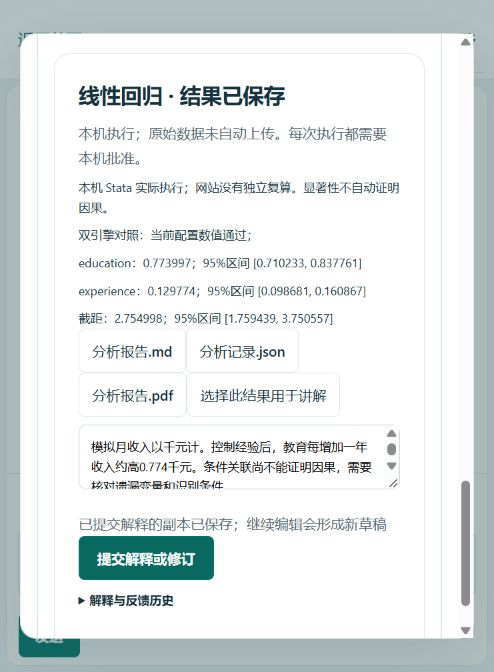

# 本机双引擎优化与验收报告

日期：2026-10-15。状态：候选实现，未替换公网 V31。已有 V32 智能辅导候选也不因本轮测试标为上线完成。

## 已实施

1. Stata 模板禁用变量缩写，显式 scalar() 读取估计值、标准误、p值、临界值、样本量及自由度。固定效应和 DID 不再导出错误 p=1。旧结果保留原文并在读取时标记待重验。
2. 本机助手增加旧 MCP、stata-code/PyStata、StatsPAI Python 适配器。固定审计提交、Python3.11、60项实际依赖版本；安装在独立环境，保留 MIT 许可证。
3. 任务新增 engine_id、bridge_id、comparison_id。不自动切换软件，对照只在明确要求时顺序执行。StatsPAI 仅开放现有三方法；DID 显式交互项加双向固定效应。
4. 输入、归一化输入、代码、适配器与参数哈希冻结。网页核对之后仍须本机批准执行，完成之后另行批准摘要上传。完整输入、日志和原生结果不自动上传。
5. 上传结果绑定已批准引擎、输入和方案，服务端校验样本与统计量并重新判断对照状态。对照不依据客户端宣称的通过，不证明因果识别。
6. 报告与解释继续使用持久任务版本；新增 Python 结果可选定讲解。首页仍只有两个入口。本机面板放入“提交材料”，没有增加首页按钮。
7. 修复本机页面内嵌脚本换行错误。增加 Windows Job Object 归属保护，实际解释器在保护建立后才计算，避免 venv 启动器产生孤立工作进程。

## 真实计算

| 方法 | 样本 | 真实 Stata 结果 | 新旧 Stata 桥 | StatsPAI 对照 |
|---|---:|---|---|---|
| OLS | 160 | 教育 b=0.7739970340；p=2.378155945e-54 | 一致 | 当前模拟 HC1 配置通过 |
| 个体＋年份固定效应 | 384 | 数字化 b=1.2761202322；p=1.151548232e-21 | 一致 | 自由度／修正不同，无法比较 |
| 同批多时期 DID | 384 | b=-1.8352542917；p=2.648053217e-18 | 一致 | 自由度／修正不同，无法比较 |

StatsPAI 原生 feols 固定 ssc=fixest、保留单例以匹配当前 xtreg 样本规则；推断使用其 df_resid。没有把 Python 结果伪装成 Stata，没有改写统计量来追求一致。

## 验收台账

| 检查 | 结果与证据 |
|---|---|
| 当前账号协议闭环 | 九条路径通过：旧 MCP三方法、新桥＋显式对照三方法、Python单独三方法。每条覆盖配对、未批准不执行、未批准不上传、幂等请求、解释与 JSON 报告版本。见 docs/local-dual/protocol-evidence.json |
| 新桥隔离／取消 | 真 Stata 两会话隔离、取消只影响目标会话、重建通过；取消约0.016秒。见 bridge-controls.json |
| 新桥硬超时 | sleep130秒在120.016秒超时；之后重建成功。见 bridge-controls.json |
| 助手取消 | 旧 MCP及新桥真实长任务取消、无上传结果，通过；协议证据含耗时 |
| 突然退出 | 专用模拟父子孙进程，在绑定句柄的实际父进程退出后所属树消失。见 process-guard.json；不等于真实电脑休眠验收 |
| 异常数据 | 缺失删除后159行；阻止缺失、共线、错误方差参数均拒绝。见 edge-evidence.json |
| 真实浏览器 | 注册→双入口→提交材料→配对→本机摘要→新桥OLS对照→本机执行批准→上传批准→解释反馈，实际点击通过。任务 ff610725-7c7b-463b-b248-f1b846ee6f2d |
| 导出 | 浏览器实际下载 MD、JSON、PDF；版本3、一次解释、OLS对照通过一致。PDF两页，首页面已视觉检查；本机复现 ZIP包含原始数据，不等于网站报告 |
| 既有回归 | auth-module、interaction、dialogue、shortcard-dom、local-drafts、local-dual-protocol通过。旧草稿测试改为具名列插入以兼容现有10列任务表 |
| 响应式 | 当前浏览器实际494px面板可用；390／768／1366视口覆盖设置没有生效，不能记作这些尺寸通过。200%放大、真实手机软键盘本轮待验证 |
| 公网闭环 | 待验证。本轮没有用本地协议成功代替当前公开 Sites 通过 |
| 第二台 Windows | 待用户提供另一台设备安装验收。源码助手ZIP已生成，不是含运行时安装包 |
| 休眠／断网恢复 | 待真实设备验收；网页离线不能宣称计算已停止 |
| 扩展异常配置 | 实际双引擎缺失删除159行、单例FE385行样本一致；聚类OLS通过数值对照；Stata省略共线项而Python拒绝，明确无法比较。见 boundary-comparison.json。不得推广这些配置为全部配置等价 |

最新实际数值证据：docs/local-dual/numeric-evidence.json。上述三方法复跑包含最终独立解释器与进程归属启动修复。曾出现的依赖加载失败保留在本机 outputs，已修复后完整复跑通过。

## 发布与默认选择

两套引擎均保留试验标识；默认真实 Stata，桥接器暂保留旧 MCP。新桥的单机计算／控制门槛已通过，但正式切换与公网发布仍等待剩余交付门槛。账号、输入、批准与报告关键链路未经公网验收，不宣布普通使用者已经完全可用。

## 复现与交付

- node scripts/export-local-fixtures.mjs
- Python3.11环境运行 scripts/local-dual-acceptance.py、scripts/local-dual-e2e.py、scripts/stata-code-controls.py、scripts/process-guard-check.py、scripts/statspai-edge-check.py。
- 本地网页使用 node scripts/build-prototype.mjs 后 node standalone/server.mjs；EA_TEST_URL 指向该实例。
- 安装见 local_stata/README.md。助手源码ZIP只使用明确允许的源码与许可证，不含凭据、输入、日志、依赖或 Stata。

