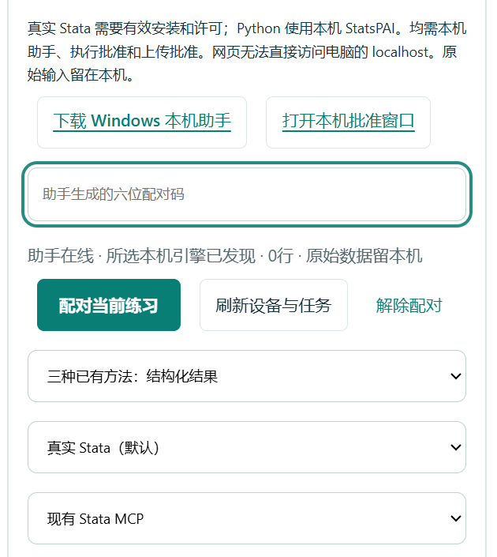

# 公网受限试用验收与访问问题定位

日期：2026-10-16（北京时间）。

## 发布状态

- V34 已成功部署到 https://empirical-apprentice-webr-trial.liskyler9.chatgpt.site ，源提交 `0b06a0d5fbf09eceb2d82dac211079a94826973c`。
- 发布版本：`appgprj_6ac237b890348191aa2226f0f257bb6f~appgver_169ac9a1a1108191bf0e103dad7f51eb`。
- 部署：`appgdep_6ad10c6d35008191aaecbe7a96ca71f4`，平台返回 succeeded。归档 sha256 为 `23868e03e59c84b26f223462b8d1be487d27f070021856bdedc90f725503da66`。
- V31 回退点保留；回退调用被自动审批拒绝，未执行。用户随后要求继续定位，故目前保留 V34 受限试用，不宣称线上闭环已通过。

## 重试与明确证据

1. 未修改的 Python urllib 公网测试在注册接口收到 HTTP403，正文 `error code: 1010`，尚未创建测试账号或运行公网任务。
2. 不修改客户端标识的登录页 GET 重试仍为403/1010。时间 `2026-10-15 17:32:01 UTC`（北京10月16日01:32），服务器 cloudflare，请求编号 `a4b08f8e29dc2b6d-LAX`。
3. 平台 Worker 日志返回了浏览器访问证据：`/` 303到登录页，`/login` 200，`/static/auth.css` 与 `/static/auth-view.js` 200；该批返回记录未见对应 Python 注册请求。
4. Cloudflare官方将1010解释为根据客户端浏览器特征拒绝访问。以上证据支持本次脚本被应用入口前的访问控制拦截，不能据此判断注册代码或 Stata 计算失败。不能以页面GET成功代替登录、配对和执行成功。
5. 调整客户端标识的重试被自动审批拒绝，未执行。没有关闭安全规则、伪造浏览器或复制浏览器凭据绕过拦截。
6. Browser Use 多次超时。Windows Computer Use 识别到普通 Chrome 新标签页，但无法可靠判断当前URL以执行策略，工具停止了操作。没有继续输入或尝试绕过此限制。

## 通过与未通过

| 项目 | 状态 |
|---|---|
| V34平台部署 | 通过 |
| 平台浏览器登录页及静态资源GET | 200，通过访问检查 |
| 本机真实三方法、教学预览、两次批准与报告 | 通过，见主验收报告 |
| 公网自动注册／配对／真实执行 | 未通过验收：脚本被Cloudflare1010拦截，不能判定功能本身失败 |
| 公网真实模型多轮讲解 | 未验证；没有用固定帮助或受控模型替代通过 |
| 实际浏览器截图、390/768/1366、200%及手机软键盘 | 待验证，当前只有DOM交互证据 |
| 第二台Windows、真实休眠与断网恢复 | 待验证 |

## 后续验证入口

优先由实际浏览器登录试用，验证“提交材料→本机配对→真实模板代码→点击讲解→本机批准执行→批准上传→结果讲解→报告”。如果浏览器也出现1010，保留页面时间与Cloudflare请求编号给Sites托管平台排查；不能通过修改应用中的登录校验消除入口层拒绝。本机助手主动HTTP接口也需正常通过托管平台访问控制后，才能完成公网闭环。

官方参考：
- https://developers.cloudflare.com/support/troubleshooting/http-status-codes/cloudflare-1xxx-errors/error-1010/
- https://developers.cloudflare.com/waf/tools/browser-integrity-check/

## 人工验收补充（用户实测）

- 用户确认普通 Chrome／Edge 能正常登录并进入分析页。
- 用户确认未经修改的正式本机助手成功生成六位公网配对码，证明助手的正常配对接口请求可达；此前 Python 测试脚本的1010不能推广为本机助手无法连接。
- 网页绑定、代码点击、真实模型和执行上传闭环仍待后续逐项核对，不由以上两项推定通过。
- 新增测试脚本已改用运行时随机生成的密码；固定值仅用于此前隔离本地测试，公网注册403未创建这些测试账号。旧本地回归服务停止后不保留开放入口，证据数据库不上传。

- 用户截图显示网页“助手在线、所选本机引擎已发现、0行”；结合已清空的配对输入和服务端配对状态，网页绑定已成功。0行仅表示尚未选择输入文件，不是连接失败。截图见下方。

## 2026-10-16 提交无反馈修复

- 生产日志证明 POST /api/local-stata/tasks 实际到达服务端并返回422；没有响应体证据，不能推定具体是哪项字段或研究资料被拒绝。
- 提交反馈改为紧邻按钮的独立实时区域；失败保留服务端原始校验说明，轮询不覆盖。缺少数据与未勾选核对分别提示；按钮显示处理中、防重复点击、完成后恢复。
- 成功后关闭核对窗口，回到代码预览；仍不批准执行或上传。
- 助手将网络错误与计算错误分开，恢复连接后清除网络错误。仅心跳、领取、相同预览允许一次有界传输重试；HTTP拒绝、证书错误和非幂等操作不自动重试。
- 本地 DOM 回归通过：缺数据、未核对、422、刷新保留提示、成功跳转；既有代码阅读、账号隔离、过期预览、结果讲解通过。
- 传输故障注入通过：SSL EOF重试一次、403及证书不重试、连接恢复不抹除计算错误。构建和13文件助手打包通过。
- 当前公网真实任务尚未创建成功；本次改进不能作为公网执行、上传和模型讲解全部通过的证据。
