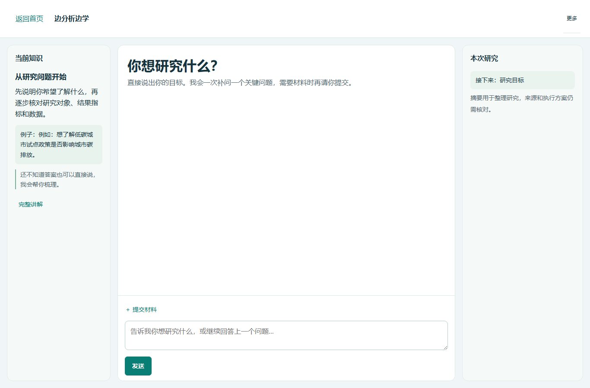
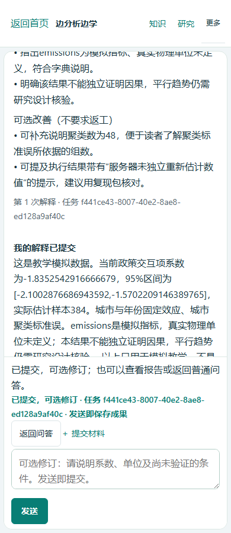
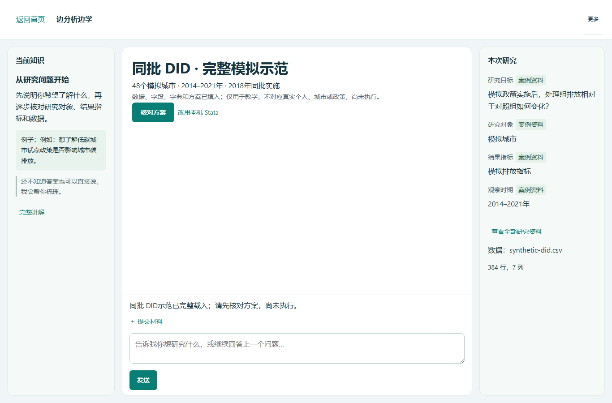
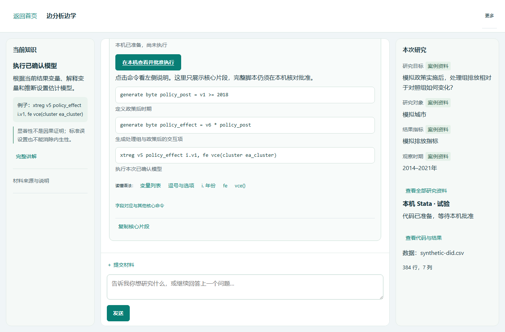
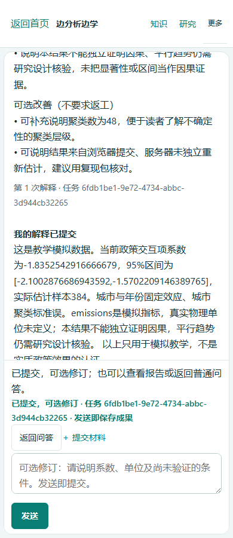

# 核心体验测试验证报告

日期：2026-10-20。基线 V42；本报告区分真实执行、自动化协议及待验事项。

## 已取得证据

| 链路 | 结果与证据 |
| --- | --- |
| 独立完整案例 | Worker＋独立 SQLite 实测：初始化384行同批DID、2018年、来源及字典；并发重试同一练习，原研究不变，刷新恢复；无自动模型调用或计算。`outputs/core-experience-regression.json` |
| Stata 文件准备 | 包内哈希与字典、准备回执先落盘、重启复用、修改文件不覆盖、错误版本／练习／配对拒绝，未执行计算。`scripts/core-assistant-regression.py` |
| Stata 实际点击闭环 | 独立 Chromium 与专用助手：配对→自动文件准备→DID字段→代码讲解→本机批准→真实Stata→批准上传→实际样本讲解→MD下载。实际384样本，上传前网站无结果。`outputs/v43-stata-browser/acceptance.json` |
| 真实三方法 | 两个 Stata 桥及 Python 均实际运行OLS160、FE384、DID384。两个Stata桥得到一致的核心输出；Python FE/DID推断口径不同，不能宣称全部数值等价。`outputs/dual-acceptance-1792404080530078400/summary.json` |
| 解释反馈 | 真实DeepSeek重放两份原正确答案，均无必须修正；错误系数、单位倍率、显著性冒充因果被指出。`outputs/v43-feedback-live.json`。结构校验另测缺引用、矛盾及无效路径。 |
| 现有功能 | 登录成本12、账号隔离、双入口、八阶段、手算、报告往返、保存并发、迟到响应、焦点保持、指南及中断恢复协议回归通过。DOM／协议不冒充实体设备或数值执行。 |
| 浏览器R | 最终实际Chromium连续通过DID384、OLS160、FE384；两次解释保存、MD/PDF/ZIP真实下载与三种宽度通过。冷启动另有两次180秒失败，保留证据。`outputs/v43-browser-final/acceptance.json`。 |

## 已修复的实际问题

- 隐藏的OLS残留角色仍可进入缺失筛选：改为前后端规范化，不仅隐藏控件。
- 新配对沿用旧输入及迟到心跳：输入与异步响应均绑定配对快照。
- 同一CSV被误识别为固定效应案例：任务从服务端示范身份记录案例，哈希只标识数据。
- 模型将正确的“160行模拟样本”要求改为同义表达：数值纠错增加实际值、学生声称值与四舍五入检查。
- 实际代码测试最初定位到折叠区域按钮：修正测试定位，真实可见核心代码操作已通过；未把脚本选择器错误当成产品缺陷。

## 失败、限制与待验

- 浏览器R的后续初始化超时：`outputs/v43-browser/initialization-timeout.json`。保留180秒上限，不以延长时限或虚构结果通过。
- 本轮专用浏览器／桌面工具初始化失败；使用项目测试脚本驱动实际隔离Chromium完成点击，未使用用户浏览器资料。
- 390／768／1366px已有真实浏览器走查；200%实际浏览器缩放、当前实体手机软键盘、第二台Windows、真实休眠／物理断网仍待验。
- 本机准备的重启／网络回执是受控验证，不代表所有物理断网场景通过；不记教学掌握或正式教学效果。
- 当前没有生产数据库导出凭据，不宣称生产灾备已完成。V42源码、助手包已保存；本轮数据库只做增量建表，历史数据不重写。
- 大陆／JoyCode部署、云端软件、长期清理及生产恢复不随本轮完成。原有未跟踪JoyCode本机规则保留并排除站点源码发布。

## 发布门槛与回退

基线源码 `0def2e4b79ed2e346fa59b2a1c7a57dd05c239e5`；备份 `outputs/v43-baseline/`。
V42回退版本：`appgprj_6ac237b890348191aa2226f0f257bb6f~appgver_31f887be736c8191be322efb827a821a`。
关键账号、保存、批准或结果关联失败时恢复该版本。新增表可保留供旧版忽略，不删除生产数据。实际发布、源码与GitHub提交在完成后追加。

## 页面证据

发布前真实公网V42：

新版完整示范：

本机实际代码：

390px实际浏览器：

## 最终本地复验

- Chromium `151.0.7922.34`实际点击三种R方法全部通过；DID两次解释后记录版本3，网页JSON与ZIP的`export_version.json`、独立下载MD逐字一致。PDF6页，首尾页已渲染检查，无额外空白页。
- Stata完整浏览器链路再次通过，实际样本384；本机未批准前无结果，未批准上传前网页无结果，真实模型讲解关联同一任务，报告可下载。
- 连续三次打开“提交数据”DOM回归已补充；实际浏览器连续DID→OLS→FE也覆盖该问题。
- 切换练习清理正式解释身份及输入提示，成功创建计算后清理过期“尚未执行”提示。
- webR诊断确认慢在外部`R.wasm`、依赖索引及包下载，不是未知计算结果；`outputs/v43-runtime-probe.json`记录待完成资源与180秒终止。最终复验成功不代表所有首次网络环境稳定。
- 复验命令入口：`core-experience-regression.mjs`、`core-assistant-regression.py`、`core-experience-browser.mjs`、`core-stata-browser.mjs`、`core-feedback-live.mjs`；现有`interaction-*`、`shortcard-*`、`stata-teaching-*`、`optional-metadata-*`、`auth-*`、`model-recovery-*`、`webr-lifecycle-*`相关回归通过。

## 2026-10-20 公网候选失败与修复

V43受限发布后发现两处阻断，已回退V42（回退部署 `appgdep_6ad6488f29c48191953e2e0ccae23534`），未把本地通过冒充公网通过。

- 正式解释读取真实结果存在异步窗口：结果尚未读完时发送可能误走普通聊天。现在读取期间立即禁用发送，绑定练习及请求序号，就绪后才能提交；读取失败保留输入。新增延迟响应回归通过。
- 助手取消已完成任务会错误改变终态，阻断新配对。现在终态取消为幂等空操作；迟到心跳不能重开上传，重新配对清空旧输入。真实本机HTTP回归通过。
- 失败证据保留于 `outputs/v43-public-browser` 和 `outputs/v43-public-stata-browser`，不删除失败记录。

## V44 公网真实回归及恢复补测

V44运行源码 `b10ba6f13b8f18b0f52661cadcca7aef8ce2050c`。公网真实浏览器通过注册、双入口、独立DID、刷新恢复、R三方法真实计算、正式解释及可选修订、MD/PDF/ZIP下载、390/768/1366px无整页横溢。记录版本3的JSON、ZIP清单及MD逐字比对通过，PDF为6页A4且首尾已检查。证据 `outputs/v44-public-browser`。

公网Stata已通过配对、自动准备、实际代码、两次批准、384样本真实计算、任务绑定模型讲解及MD下载。证据 `outputs/v44-public-stata-browser`。补测从历史练习恢复时发现：连接面板关闭导致终态任务不刷新，结果仍已保存，但入口未恢复。因此再次回退V42，修复为每次切换练习只读恢复设备及任务，不依赖面板展开、不重跑、不上传。补测脚本最初使用隐藏旧按钮，随后改为可见“历史练习”入口；测试选择器问题与产品恢复问题分别保留。

V45公网R三方法、正式解释和导出复验通过；Stata刷新后仍暴露首次加载与远端读取时序差异，已回退V42。保存任务和执行软件均正确，问题是首次加载守卫和恢复读取时序；最终改为首次也初始化本机状态，并立即从已认证会话快照恢复任务，再异步更新设备状态。关闭连接面板且设备读取被延迟的回归已通过，不生成任务或上传请求。失败证据 `outputs/v45-public-stata-browser` 保留。

## 最终 V46 公网验收与交付

2026-10-20：V46保留为当前受限试用版本。运行源码 `51b64bdaf2a2be1d4d765e76a52a6197c1259a1f`；版本 `appgprj_6ac237b890348191aa2226f0f257bb6f~appgver_33d2023fe3888191b2b2b5c0c68c26ae`；成功部署 `appgdep_6ad6e8926574819186bfa73a0f3f1a39`。网址保持 https://empirical-apprentice-webr-trial.liskyler9.chatgpt.site/ 。后续交付记录只更新文档和截图，不改变该运行源码。

| 最终验收 | 结果 |
| --- | --- |
| 公网R三方法 | Chromium151真实点击：DID384、OLS160、固定效应384，完整模拟资料无需猜单位；核对后才执行。`outputs/v46-public-browser-auth/acceptance.json` |
| 公网R正式成果与报告 | 两次真实模型反馈、记录版本3；JSON/ZIP版本及MD逐字核对通过，PDF6页A4且已渲染首尾；390/768/1366px无整页横溢。 |
| 公网Stata完整链路 | 配对、自动准备固定数据、真实代码、本机执行批准、上传批准、任务讲解、报告均通过。`outputs/v46-public-stata-browser/acceptance.json`，共9项真实浏览器检查。 |
| Stata刷新及正式成果 | 关闭连接面板后刷新仍恢复原终态任务；两次正式解释均为consistent且无必须修正，持久记录版本4。JSON/MD读取相同版本，PDF4页且已渲染首尾。 |
| 本轮注册限流 | 连续验收触发真实429，错误提示可见。保留 `outputs/v46-public-browser/failure.json`；改用既有隔离测试账号完成最终R验收，没有修改限流策略。 |
| 恢复与安全 | 延迟配对读取的已认证任务快照恢复、迟到响应、终态取消、两次批准、跨账号不可读及源码包排除项均有专项回归；不代表实体休眠／所有物理断网通过。 |

Stata网站现有下载为MD、JSON、PDF；助手的本机复现ZIP保留实际输入与运行材料，生成于执行阶段，不宣称它包含后来在网站提交的解释修订。浏览器R网站复现ZIP则包含同版本的解释和报告。原始输入不因报告下载而自动上传。

新版助手包 `static/local-stata-assistant.zip` 包含20个允许文件及清单，未包含连接令牌、运行记录或真实学生数据。使用旧助手者需下载更新并重启；本轮专用18768测试助手与用户8767助手相互独立。

前后截图：V42见上文；以下均为最终公网真实浏览器截图。

源码及GitHub同步以同一文件清单和Git blob哈希核验；最终提交链接随交付消息提供。以上证据不消除前文的冷启动网络、实体手机、200%实际缩放、第二台Windows、真实休眠及灾备待验项。

