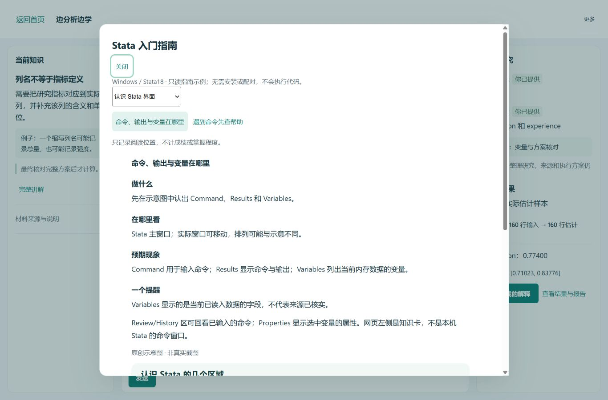
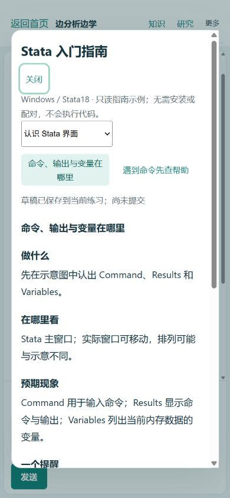

# 按需 Stata 操作教学与研究核验：优化及验收

日期：2026-10-19。生产回退基线 V41，源码 `16dc2b90da0c0901a91f92b171b2db00d862ee5f`；回退站点版本 `appgprj_6ac237b890348191aa2226f0f257bb6f~appgver_561e53440b948191b5e03b54ba710b2f`。本轮发布标识见文末。

## 差距及修改

| 原问题 | 本轮处理 |
|---|---|
| 只有准备任务后才出现代码卡 | “更多 → Stata 入门指南”，七章22步，无需安装或配对；首次选择给可关闭提示 |
| 教学材料混用十二阶段、旧课节 | 从八阶段课程同源生成网页手册、README、实验包说明；保留8图21题和原Python实验 |
| 教学案例用途不清 | 标明主线同批、独立分批辨别卡及人为统计示意图，均保留模拟标签 |
| 知识只按字词排序 | 软件、问题主题、实际方法、当前步骤共同筛选；未定方法不默认展示 fixest 文档 |
| 引导无当前操作入口 | 活跃引导仅增加一个“打开当前操作”；普通知识咨询不强制推进 |
| 样本记录不易理解 | 页面、MD与JSON共用只读投影；未知值不补零，省略项与观测分开 |
| 指南阅读后可能阻断发送 | 补受约束的阅读草稿白名单；仅存课节、位置、版本，不改研究版本或成绩 |
| Stata 切换 R 后面板被遮住 | 方案继续入口清除旧本机面板样式 |
| 正式作答被核对窗口遮住 | 打开作答后关闭核对窗口并聚焦对话框；修订提示同步更新 |
| PDF 末尾出现空白页 | 空行不再触发新页；真实下载从5页修正为4页并逐页检查 |

计算模板、冻结脚本、批准哈希及两次本机批准规则未修改。源码与原 V41 的 `executor/engines.py`、`executor/stata_teaching.py`、助手执行实现逐字节一致。更新助手包只更新操作说明与来源清单。

## 实际验收

| 项目 | 结果与证据范围 |
|---|---|
| 构建、账号、严格双入口 | 通过；真实 bcrypt cost12、登录/退出/隔离与双入口 smoke；注册确认表单 DOM 通过 |
| 指南七章22步 | 通过；白名单422、过期版本409、未配对可读、位置恢复、模型未配置固定说明、无任务及成果生成 |
| 知识匹配 | 通过；缺失、单位、界面、命令、结果；准备阶段不引入未选软件或默认方法 |
| 样本边界 | 通过；零排除、分项缺失、重叠记录拒绝、历史字段缺失、省略项、未批准上传不展示；不改持久结果 |
| Stata 三方法真实执行 | 通过；独立账号与助手，OLS 160行、固定效应384行、同批DID 384行；真实脚本行与预览对应；等待批准/上传、取消及隔离协议检查 |
| 真实浏览器 Stata | 通过；本轮点击配对、模拟OLS核对、真实命令阅读、本机批准、实际执行、另行批准上传、样本与结果卡；任务 `84bd0db7-dd95-4ac1-b2c0-53c6565a3d9d` |
| 真实浏览器 R | 通过；模拟数据→真实 DeepSeek 建议→预览应用→方案确认→webR / fixest0.14.2→真实OLS→解释与二次修订→报告；任务 `9dbafd9a-da2d-472b-9588-3a406f580267`，160行 |
| 真实 DeepSeek 指南 | 通过；界面、缺失、固定效应标准误三轮；绑定正确指南步骤，无任务/研究版本改变；不是受控模型证据 |
| 报告一致性 | 通过本次R任务；版本3、两次修订；ZIP内MD与独立MD字节一致，JSON结果一致；浏览器实际下载PDF4页，中文、版本3、两次修订、样本说明和图表逐页检查 |
| 390 / 768 / 1366px | 通过指南浏览器检查和截图；无横向页面溢出；不是实体手机软键盘验收 |
| 键盘、减少动画、轮询 | 指南Tab可达；现有DOM轮询焦点及草稿回归通过，减少动画使用现有规则；未重跑实体设备 |
| 200%缩放 | 待人工；浏览器工具快捷键未改变实际缩放，不能把普通宽度截图当作200%通过 |

测试脚本：`operation-guide-regression.mjs`、`operation-guide-dom.mjs`、`operation-guide-live.py`、`stata-teaching-dom.mjs`、`stata-teaching-regression.mjs`、`auth-module-smoke.mjs`、`auth-form-dom-smoke.mjs`、`shortcard-dom-regression.mjs`、`interaction-regression.mjs`、`optional-metadata-regression.mjs`、`model-recovery-regression.mjs`、`textbook-knowledge-regression.mjs`。脚本中的受控模型与DOM结果不替代上表另列的真实模型和浏览器结果。

材料生成检查：ZIP CRC通过，6个原条目保留，除README外5个文件与备份逐字节一致；实际Python实验清洗16行、DID=-15；连续生成哈希相同。

## 截图及本地证据

均为隔离候选版真实浏览器截图；图内软件界面另明确标注为原创示意。生产V41源码备份位于忽略目录 `outputs/operation-teaching-baseline/source-v41.zip`。本轮未取得新的 V41 现场截图，不将旧版本截图冒充前后对比。

未公开的合成任务证据在 `outputs/operation-guide-{unit,dom,live}.json`、`outputs/stata-teaching-e2e-1792346680241663500/`、`outputs/operation-exports/`、`outputs/operation-report-final.pdf`；不包含用户原始数据。模型密钥仅在忽略的 `.env.local` 中，未进入源码、报告或发布包。

## 冻结边界

本轮通过的受限场景可以试用，不宣称全面生产验收。仍待：200%人工复查、当前版本实体手机软键盘、第二台Windows、真实休眠与断网恢复、正式教学效果与教师审校、长期清理、生产恢复、云端R与大陆/JoyCode部署、云端Stata/EViews、文献/数据库/写作及新估计方法。既有三方法之外没有新增软件能力。

## 发布与同步记录

- V42 已发布，时间 `2026-10-18T19:00:31Z`（北京时间2026-10-19）。网址：https://empirical-apprentice-webr-trial.liskyler9.chatgpt.site/
- 发布源码：`5a606a3ee047f5e4a42af6bb3e872ec9d710813e`。
- Sites版本：`appgprj_6ac237b890348191aa2226f0f257bb6f~appgver_31f887be736c8191be322efb827a821a`。
- 部署：`appgdep_6ad5174273b48191b9784069c7573a72`，状态 `succeeded`，原公开访问范围保留。
- GitHub功能提交：`8fabb4387879a58fe813148025df7bc730206ae9`，44个变更文件的Git blob哈希均与本地发布提交一致；两张截图和两个ZIP均单独核对哈希。仓库仍为用户现有私有仓库。
- 发布后普通PowerShell客户端：登录页200，注册→登录态→七章指南→三轮真实DeepSeek讲解通过；不会改变研究版本或创建计算任务。证据 `outputs/operation-guide-public-model.json`。
- Python客户端注册403；普通PowerShell实际访问成功。公网浏览器工具超时，未取得发布后浏览器点击证据；不归为已经验证通过，也不等同于产品逻辑失败。发布前本地真实浏览器 R / Stata 点击证据如上。
- 密钥扫描、助手13文件清单及两个ZIP CRC通过；不上传原书、原始数据、密钥或测试运行状态。本轮功能冻结，后续只处理实际阻断。

本次追加仅更新交付说明；上述发布源码标识指实际运行构建，说明提交可在GitHub历史中另行追溯。
